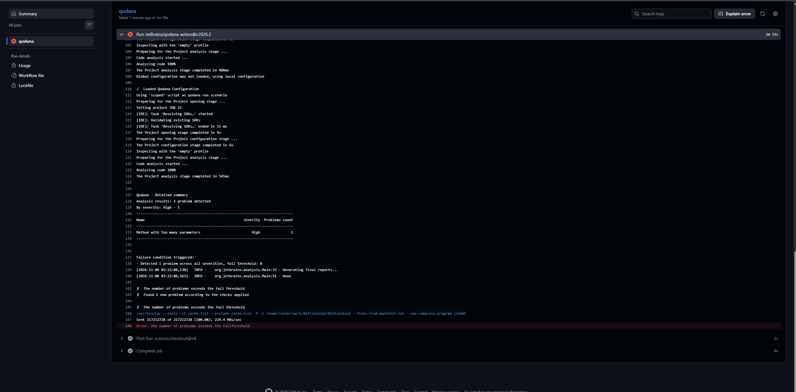
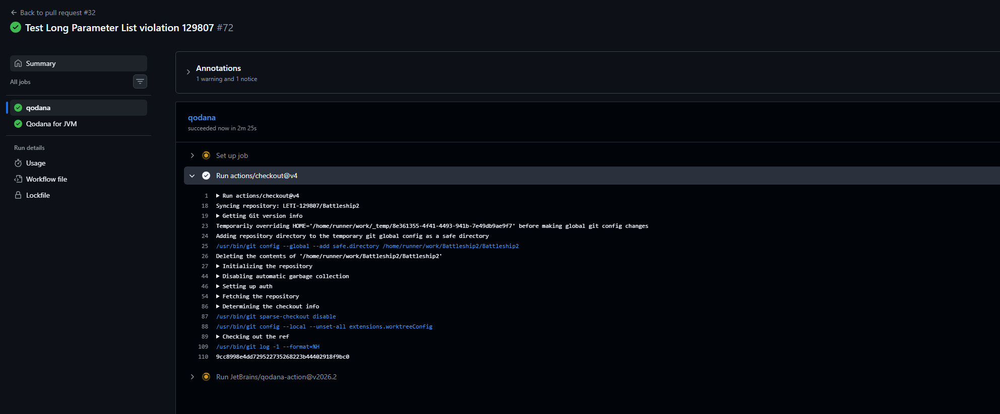

# Tabela de Mapeamento — Long Parameter List

**Aluno:** LETI-129807  
**Projeto:** Battleship2  
**Cheiro de código:** Long Parameter List

## 1. Tabela de Mapeamento

| Campo | Descrição |
|---|---|
| Cheiro de código (Fowler) | Long Parameter List |
| Descrição | Ocorre quando um método recebe um número excessivo de parâmetros, dificultando a sua leitura, compreensão, utilização e manutenção. |
| Inspeção IntelliJ/Qodana | Method with too many parameters |
| ID da inspeção | `ParametersPerMethod` |
| Métrica utilizada | Número de parâmetros de um método (PAR) |
| Valor-limite | 5 parâmetros |
| Condição de deteção | Métodos com mais de 5 parâmetros |
| Ferramenta | Qodana for JVM Community 2026.2 |
| Configuração | `qodana-129807.yaml`, com o perfil `empty` e a inspeção `ParametersPerMethod` ativada através de `include` |
| Limitações | A inspeção contabiliza os parâmetros, mas não avalia diretamente a complexidade, a finalidade ou o contexto do método. Pode assinalar métodos legítimos e não identificar métodos difíceis de compreender que tenham poucos parâmetros. |

## 2. Configuração da Inspeção

Para analisar o cheiro de código *Long Parameter List*, foi configurado o Qodana for JVM Community 2026.2 através do ficheiro `qodana-129807.yaml`.

A configuração utiliza o perfil `empty`, no qual é ativada explicitamente a inspeção `ParametersPerMethod`. Desta forma, a análise fica direcionada para a identificação de métodos Java com um número excessivo de parâmetros.

Foi definido um limite de cinco parâmetros. Assim, qualquer método com seis ou mais parâmetros ultrapassa o valor estabelecido e pode ser identificado como uma violação.

Foi também configurada a condição de falha `any: 0`, que determina que o *quality gate* deve falhar quando for identificado pelo menos um problema abrangido pela análise.

A execução automática é realizada através do workflow `Qodana smell gate 129807`, definido no ficheiro `.github/workflows/qodana-smell-129807.yaml`.

Este workflow é executado através do GitHub Actions em Pull Requests, em pushes para a branch `main` e quando iniciado manualmente.

A integração da inspeção no processo de integração contínua permite identificar potenciais problemas de qualidade antes de as alterações serem integradas na branch principal.

## 3. Validação do Quality Gate

Para comprovar o funcionamento da inspeção, foram realizados dois testes no [Pull Request #32](https://github.com/LETI-129807/Battleship2/pull/32).

O primeiro teste teve como objetivo confirmar que o Qodana identificava uma violação e fazia falhar o *quality gate*. O segundo permitiu verificar que, após a remoção da violação, a análise terminava com sucesso.

### 3.1. Teste negativo — Deteção de uma violação

Foi introduzido temporariamente na classe `PdfExporter.java` um método denominado `testeLongParameterList`, com seis parâmetros do tipo `int`.

Este método foi criado exclusivamente para testar a inspeção, uma vez que ultrapassava o limite de cinco parâmetros definido na configuração.

Após o commit e o push, o GitHub Actions executou automaticamente o workflow do Qodana.

A ferramenta identificou corretamente o problema **Method with too many parameters**, com severidade **High**, apresentando uma violação no relatório de análise.

Como o *quality gate* estava configurado para não permitir problemas, a execução terminou com falha, conforme esperado.

**Resultado:** Teste negativo validado — uma violação detetada e *quality gate* vermelho.

**Evidência visual — deteção do problema:**

**Execução no GitHub Actions:** [Consultar teste negativo](https://github.com/LETI-129807/Battleship2/actions/runs/42442285517/job/128613854804?pr=32)

### 3.2. Teste positivo — Correção da violação

Após a identificação do problema, o método `testeLongParameterList` foi removido da classe `PdfExporter.java`.

A remoção foi considerada adequada porque o método tinha sido introduzido apenas para validar a inspeção, não desempenhando qualquer função necessária ao funcionamento da aplicação.

Foi realizado um novo commit e push, desencadeando outra execução do workflow.

Desta vez, o check `Qodana smell gate 129807 / qodana` terminou com sucesso, sem novas violações detetadas pela inspeção configurada.

**Resultado:** Teste positivo validado — *quality gate* verde.

**Evidência visual — análise concluída com sucesso:**

**Execução no GitHub Actions:** [Consultar teste positivo](https://github.com/LETI-129807/Battleship2/actions/runs/42442774624/job/128615329934?pr=32)

### 3.3. Comparação dos resultados

| Critério | Teste negativo | Teste positivo |
|---|---|---|
| Situação analisada | Método com 6 parâmetros | Método de teste removido |
| Violação Long Parameter List | Detetada | Não detetada |
| Número de problemas | 1 | 0 novos problemas |
| Resultado do quality gate | Falha | Sucesso |
| Estado do check | Vermelho | Verde |
| Validação | Conforme esperado | Conforme esperado |

Os resultados demonstram que a inspeção configurada conseguiu identificar a violação introduzida intencionalmente e que a sua remoção permitiu obter uma execução bem-sucedida.

## 4. Proteção da Branch Principal

Foi configurada uma regra de proteção para a branch `main`, através das definições do repositório no GitHub.

A opção **Require a pull request before merging** estabelece a utilização de Pull Requests para integrar alterações na branch principal.

Foi também ativada a opção **Require status checks to pass before merging**, com duas verificações obrigatórias:

- `checkstyle` — verifica o cumprimento das regras de estilo definidas para o código Java.
- `qodana-129807` — executa a inspeção de qualidade configurada para o cheiro de código *Long Parameter List*.

Desta forma, a integração de alterações na branch `main` fica condicionada ao sucesso das verificações obrigatórias, de acordo com as regras de proteção aplicáveis ao repositório.

Esta abordagem contribui para a prevenção de problemas de qualidade e promove uma validação automática das alterações antes da sua integração.

## 5. Reflexão Crítica

O cheiro de código *Long Parameter List* pode comprometer a legibilidade, a compreensão e a manutenção do software.

Os métodos que recebem muitos parâmetros tendem a ser mais difíceis de utilizar corretamente, uma vez que exigem que o programador compreenda a finalidade e a relação entre vários argumentos.

A inspeção `ParametersPerMethod` permite detetar automaticamente métodos que ultrapassam um limite previamente definido, contribuindo para a identificação antecipada de potenciais problemas de conceção.

A integração desta inspeção no GitHub Actions constitui uma vantagem, pois permite executar a análise de forma automática e consistente durante o desenvolvimento.

Contudo, a utilização de um limite fixo apresenta algumas limitações. Um método com seis parâmetros não é necessariamente mal concebido, tal como um método com poucos parâmetros não é obrigatoriamente simples ou fácil de manter.

A inspeção também não considera diretamente a complexidade interna do método, a relação entre os parâmetros ou a sua responsabilidade no sistema.

Por esse motivo, os resultados da análise estática devem ser interpretados pelos programadores, tendo em consideração o contexto do código.

Em situações reais, a correção deste cheiro de código pode envolver a introdução de um objeto que agrupe parâmetros relacionados (*Introduce Parameter Object*), a reorganização das responsabilidades ou a simplificação da interface do método.

No teste realizado, a correção consistiu na remoção do método, uma vez que tinha sido criado exclusivamente para demonstrar o funcionamento da inspeção.

Os testes realizados permitiram ainda compreender a importância de configurar corretamente os perfis de análise e os *quality gates*, garantindo que a ferramenta identifica os problemas pretendidos e apresenta resultados coerentes com os critérios definidos.

## 6. Conclusão

A configuração e os testes realizados permitiram validar o funcionamento do Qodana na deteção do cheiro de código *Long Parameter List*.

No teste negativo, a ferramenta identificou corretamente um método com seis parâmetros e fez falhar o *quality gate*. No teste positivo, após a remoção da violação, o workflow terminou com sucesso.

Foi igualmente configurada uma regra de proteção para a branch `main`, incluindo as verificações obrigatórias `checkstyle` e `qodana-129807`.

Desta forma, ficou demonstrado que a análise estática pode ser integrada num processo de integração contínua para apoiar a identificação de problemas de qualidade e contribuir para a manutenção de um código mais consistente, legível e fácil de evoluir.

## 7. Referências e Evidências

**Pull Requests:**

- [PR #23 — Fix Qodana Long Parameter List inspection profile](https://github.com/LETI-129807/Battleship2/pull/23)
- [PR #32 — Test Long Parameter List violation 129807](https://github.com/LETI-129807/Battleship2/pull/32)

**Execuções do Qodana:**

- [Teste negativo — Quality gate vermelho](https://github.com/LETI-129807/Battleship2/actions/runs/42442285517/job/128613854804?pr=32)
- [Teste positivo — Quality gate verde](https://github.com/LETI-129807/Battleship2/actions/runs/42442774624/job/128615329934?pr=32)

**Capturas de ecrã:**

As evidências visuais estão organizadas na pasta `qodana/evidencias/`:

- `Qodana_129807_Falha_LongParameterList.png` — deteção da violação e falha do quality gate.
- `Qodana_129807_Sucesso.png` — execução bem-sucedida após a correção.

**Configuração e automatização:**

- `qodana-129807.yaml` — configuração da análise e da condição de falha.
- `.github/workflows/qodana-smell-129807.yaml` — workflow de integração contínua.
- `.qodana/profiles/profile-129807.yaml` — ficheiro de perfil personalizado utilizado durante a configuração da inspeção.
