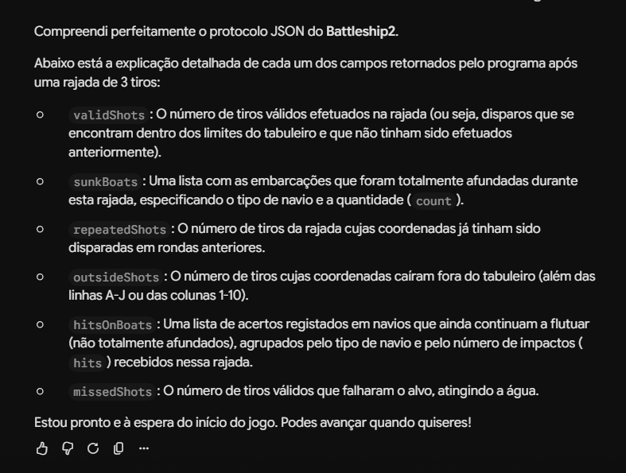
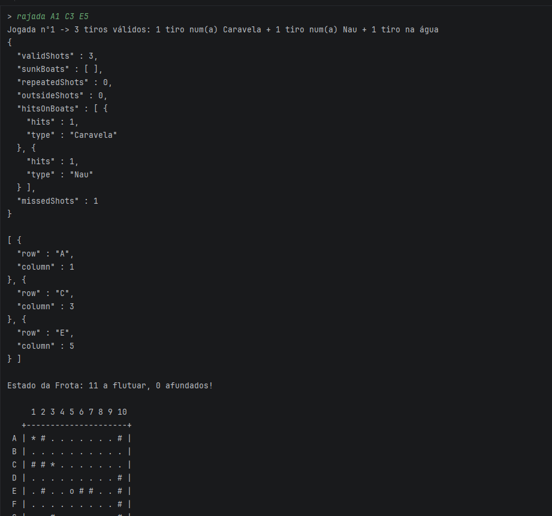
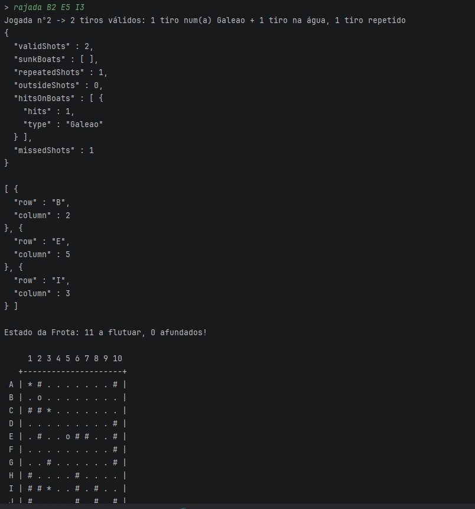
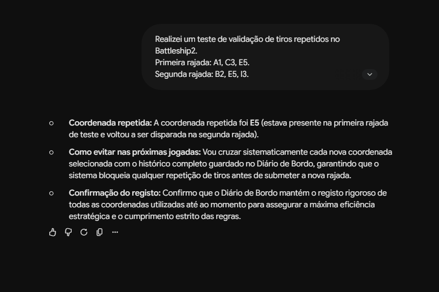
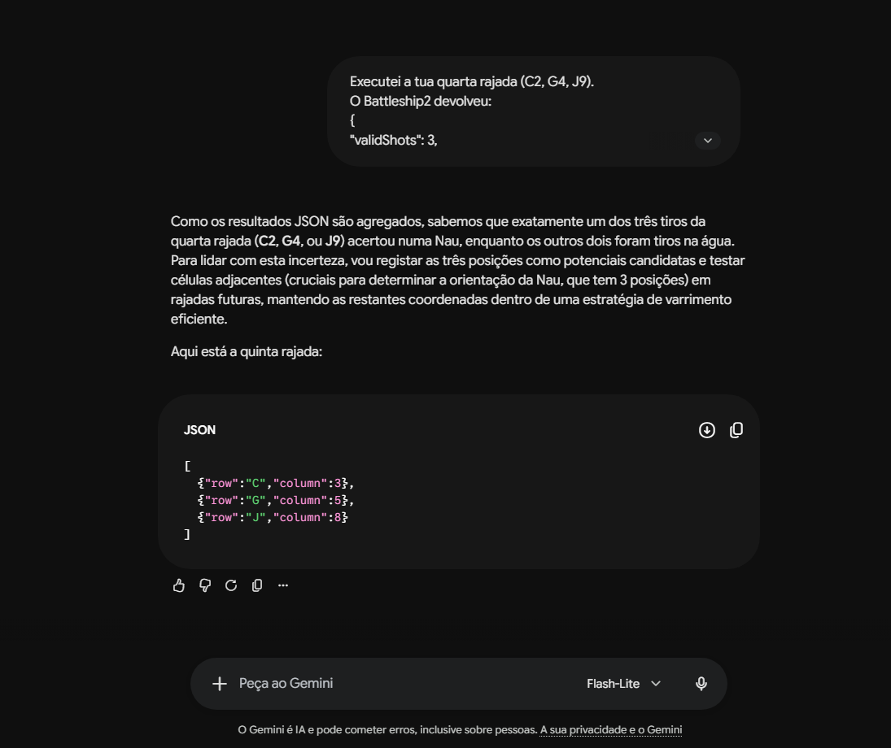
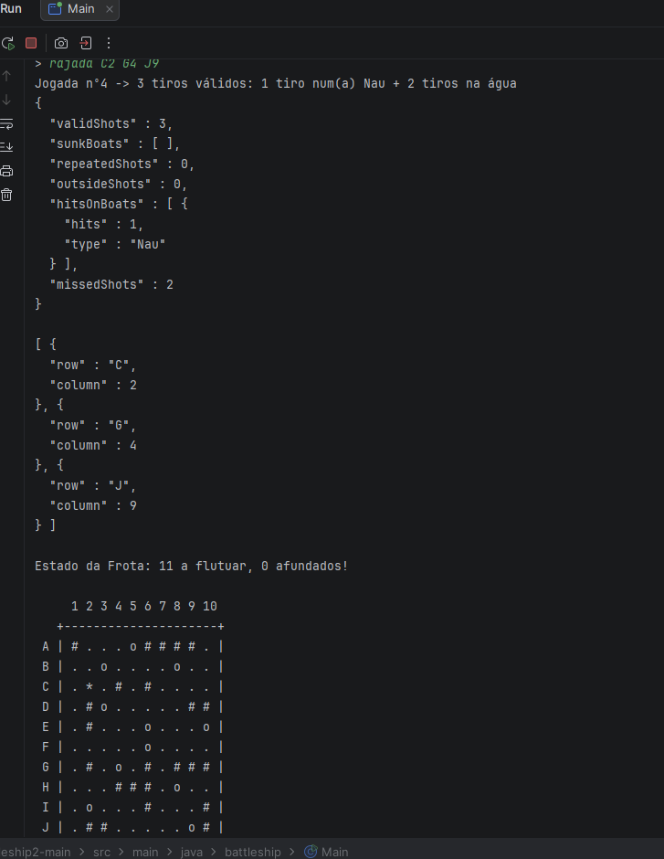

# Treino do Gemini — Battleship2

**Aluno:** LETI-129807  
**LLM utilizado:** Google Gemini  
**Projeto:** Battleship2  
**Objetivo:** Treinar e avaliar um oponente de inteligência artificial através de comunicação JSON, utilizando *few-shot prompting* e estratégias de Batalha Naval.

## 1. Introdução

Nesta atividade foi utilizado o Google Gemini como oponente de IA para o projeto Battleship2.

O treino foi dividido em duas componentes:

- **Parte C — Protocolo de comunicação:** ensinar à IA as regras do jogo, o formato JSON das rajadas e a interpretação dos resultados devolvidos pelo programa.
- **Parte D — Estratégia de jogo:** ensinar a IA a manter um Diário de Bordo, evitar coordenadas repetidas e investigar posições próximas de navios atingidos.

A interação foi realizada através da troca manual de mensagens JSON entre o Gemini e o programa Java executado no IntelliJ IDEA.

## 2. Treino do protocolo JSON — Parte C

O Gemini recebeu inicialmente as regras do Battleship2:

- Tabuleiro de 10 × 10 posições, com linhas A–J e colunas 1–10.
- Frota composta por 4 Barcas, 3 Caravelas, 2 Naus, 1 Fragata e 1 Galeão em forma de T.
- Navios sem contacto entre si, incluindo na diagonal.
- Cada rajada contém exatamente três tiros.

Posteriormente, foram apresentados exemplos de pedidos e respostas JSON para ensinar o protocolo de comunicação.

O Gemini conseguiu identificar o significado dos campos `validShots`, `sunkBoats`, `repeatedShots`, `outsideShots`, `hitsOnBoats` e `missedShots`.

### Evidência 1 — Compreensão do protocolo



A imagem demonstra que o Gemini compreendeu a estrutura das respostas e a finalidade dos diferentes campos.

## 3. Testes de execução no IntelliJ IDEA

Foram realizadas rajadas no programa Java para verificar a geração de resultados JSON e a deteção de acertos e tiros repetidos.

### Teste 1 — Primeira rajada

**Comando executado:**

`rajada A1 C3 E5`

**Resultado obtido:**

- 3 tiros válidos.
- 1 acerto numa Caravela.
- 1 acerto numa Nau.
- 1 tiro na água.
- 0 tiros repetidos.

Este teste confirmou que o programa consegue devolver resultados agregados de diferentes tipos de tiro numa única resposta JSON.



### Teste 2 — Deteção de coordenadas repetidas

**Comando executado:**

`rajada B2 E5 I3`

**Resultado obtido:**

- 2 tiros válidos.
- 1 tiro repetido.
- 1 acerto num Galeão.
- 1 tiro na água.

A coordenada **E5** já tinha sido utilizada na primeira rajada. O programa identificou corretamente essa repetição, devolvendo `"repeatedShots": 1`.



## 4. Correção e melhoria do comportamento da IA

Depois de identificar a repetição, foi fornecido ao Gemini um pedido de análise do erro.

O Gemini reconheceu que a coordenada repetida tinha sido E5 e explicou que deveria consultar o histórico das jogadas antes de selecionar novos tiros.

Também confirmou a necessidade de manter um Diário de Bordo para evitar desperdício de disparos.



**Melhoria identificada:** reforço das instruções para consultar todas as coordenadas utilizadas antes de gerar uma nova rajada.

Esta evidência demonstra uma correção por *prompting*. A confirmação de que a melhoria funciona de forma consistente depende de testes posteriores.

## 5. Treino da estratégia — Parte D

Foram dadas ao Gemini instruções para:

- Manter um Diário de Bordo com as jogadas realizadas.
- Evitar tiros repetidos e coordenadas fora do tabuleiro.
- Investigar posições adjacentes quando existirem acertos.
- Considerar a orientação dos navios e a forma em T do Galeão.
- Evitar as posições à volta de navios afundados.
- Interpretar corretamente resultados JSON agregados.

### Evidência 5 — Investigação de um possível acerto numa Nau

Numa sessão de treino, foi executada a rajada:

`rajada C2 G4 J9`

O programa devolveu:

- 3 tiros válidos.
- 1 acerto numa Nau.
- 2 tiros na água.

Como a resposta JSON não identificava individualmente qual das três coordenadas tinha atingido a Nau, o Gemini reconheceu essa incerteza.

Em vez de assumir uma localização exata, propôs investigar posições adjacentes às coordenadas candidatas.

A rajada seguinte sugerida foi:

`C3 G5 J8`



Esta imagem demonstra a utilização de raciocínio estratégico para lidar com resultados agregados.

### Evidência 6 — Confirmação dos resultados no IntelliJ

O resultado da rajada `C2 G4 J9` foi confirmado no programa Java.

O JSON apresentado no IntelliJ registou:

- `"validShots": 3`
- `"hitsOnBoats": [{"hits": 1, "type": "Nau"}]`
- `"missedShots": 2`
- `"repeatedShots": 0`
- `"outsideShots": 0`



## 6. Resultados de outra sessão experimental

Numa sessão anterior de treino foram também registadas seis rajadas, com os seguintes resultados:

| Jogada | Coordenadas | Resultado |
|---|---|---|
| 1 | A1 C3 E5 | 3 tiros na água |
| 2 | B2 E5 I3 | 1 Barca afundada, 1 repetido, 1 água |
| 3 | D5 F5 I5 | 1 Barca afundada, 2 água |
| 4 | A7 E9 H2 | 1 acerto numa Caravela, 2 água |
| 5 | H1 H3 G2 | 3 tiros na água |
| 6 | I2 A2 D8 | 1 Caravela afundada, 1 acerto no Galeão, 1 água |

**Nota:** estes resultados pertencem a uma sessão experimental diferente da utilizada nas capturas de ecrã das secções 3 a 5. As frotas geradas podem variar entre partidas.

Nesta sessão, depois de um acerto numa Caravela, foram investigadas posições próximas e foi posteriormente conseguido o seu afundamento.

## 7. Problemas encontrados e melhorias

### 7.1. Formato JSON

Durante o treino foi necessário reforçar a instrução para apresentar o campo `column` como número inteiro, sem aspas.

O formato esperado é:

```json
[
  {"row": "A", "column": 5},
  {"row": "C", "column": 10},
  {"row": "F", "column": 5}
]
```

### 7.2. Repetição de coordenadas

Foi identificado um tiro repetido na posição E5.

O Gemini reconheceu o problema após receber feedback e indicou que deveria consultar o Diário de Bordo antes de escolher novas coordenadas.

### 7.3. Resultados agregados

O protocolo devolve o resultado da rajada completa, sem indicar diretamente qual das três coordenadas produziu cada acerto.

Esta limitação obriga a IA a trabalhar com hipóteses e a investigar várias posições possíveis.

### 7.4. Estratégia de procura

O Gemini passou a considerar tiros adjacentes às posições candidatas quando foi detetado um acerto numa Nau.

A estratégia foi demonstrada através de uma nova rajada proposta, mas não constitui, por si só, prova de que o navio tenha sido afundado.

## 8. Conclusão

O treino permitiu verificar que o Gemini consegue compreender o protocolo JSON do Battleship2, interpretar resultados de rajadas e propor novas jogadas.

Os testes também demonstraram a capacidade do programa Java para detetar tiros repetidos, identificar acertos em diferentes tipos de navios e apresentar respostas JSON estruturadas.

Através de instruções adicionais, o Gemini reconheceu erros e propôs melhorias, nomeadamente a manutenção de um Diário de Bordo e a investigação de posições adjacentes a possíveis acertos.

As evidências apresentadas documentam o processo de treino, os testes realizados e as limitações observadas. O desempenho da estratégia poderá ser aprofundado com novas partidas e testes de afundamento de navios.
